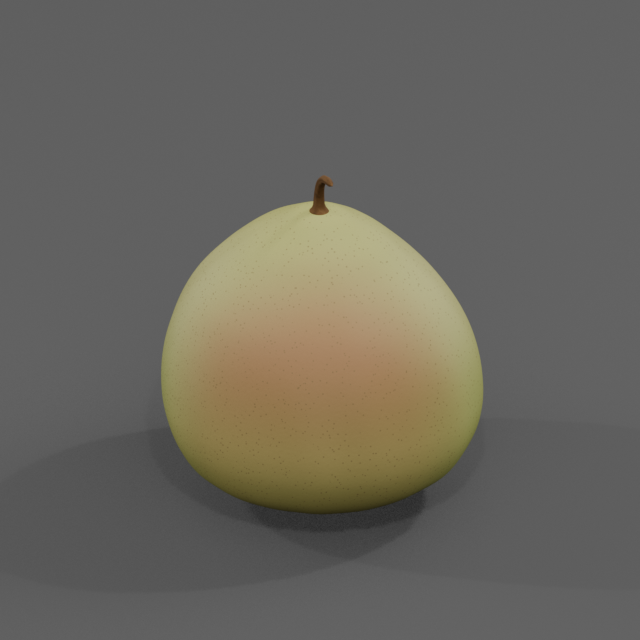
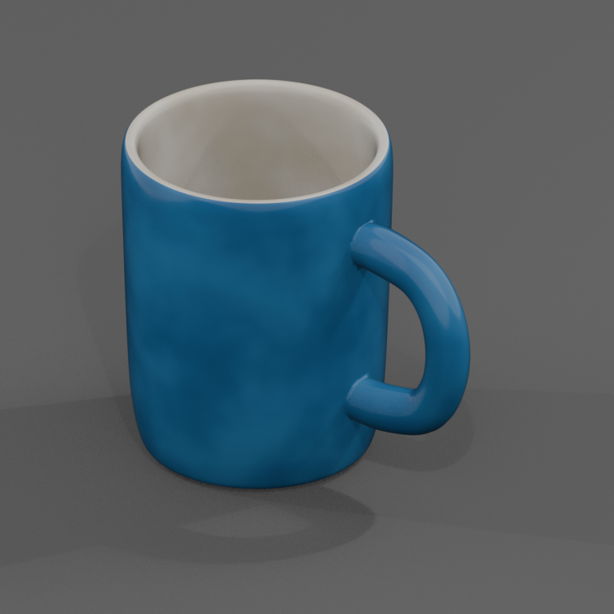
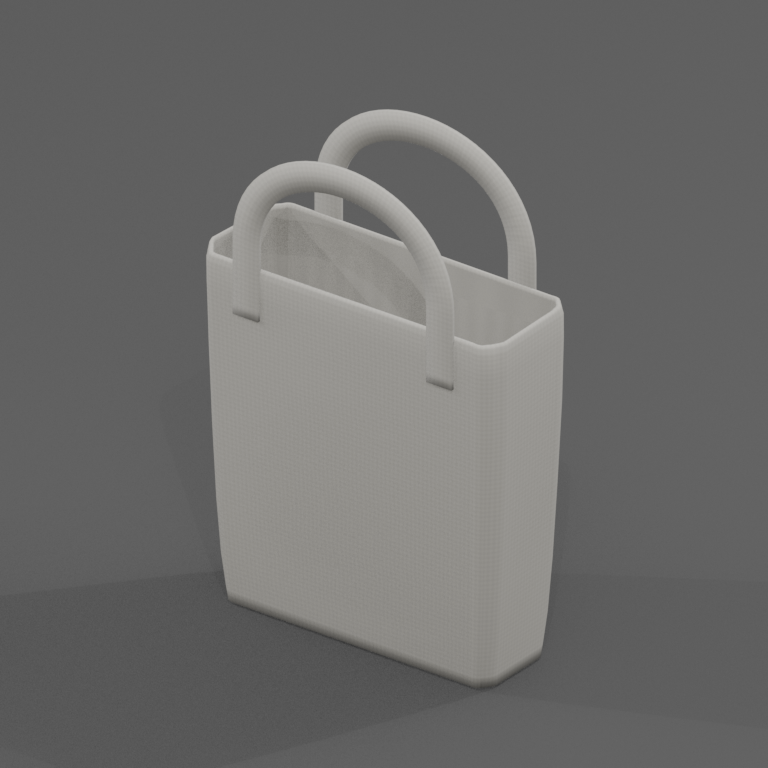
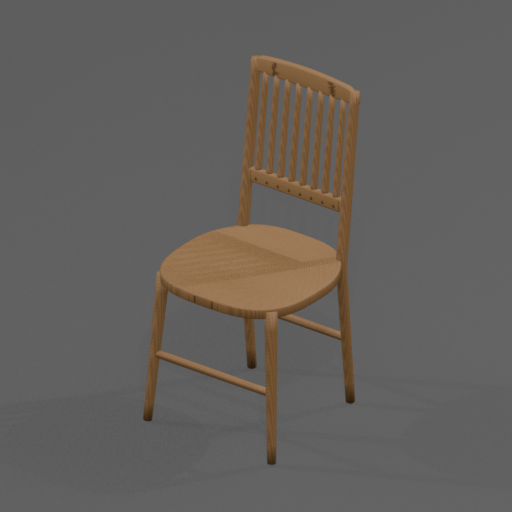

# AgentIn3d

简体中文 | [English](README_en.md)

基于 Infinigen 的三维建模 Agent，支持文字、单主体参考图及二者组合。Agent 编写程序化模型代码，生成多视图、可编辑 BLEND 和含材质的 GLB。

核心代码、Skills 与建模知识位于 `inf_agent/`。当前版本为 1.1，支持静态单体资产。Terrain 和 Sim 暂未适配。

## 效果展示

以下为 `inf_agent/outputs` 中生成资产的预览图。

<table>
  <tr>
    <td align="center"><br>香梨</td>
    <td align="center"><br>蓝釉陶瓷杯</td>
  </tr>
  <tr>
    <td align="center"><br>帆布包</td>
    <td align="center"><br>木质座椅</td>
  </tr>
</table>

## 安装

准备 Python 3.11，从本项目仓库获取源码，进入根目录。

```bash
git clone https://github.com/yaojinzhen/AgentIn3d.git
cd AgentIn3d
```

以下两种方式任选其一，均在项目根目录创建 `.venv`。

### 方式一 使用 uv

尚未安装 uv 时，先安装 uv，也可参照[官方安装说明](https://docs.astral.sh/uv/getting-started/installation/)。

Windows PowerShell

```powershell
powershell -ExecutionPolicy Bypass -c "irm https://astral.sh/uv/install.ps1 | iex"
$env:Path = "$env:USERPROFILE\.local\bin;$env:Path"
```

Windows CMD

```bat
powershell -ExecutionPolicy Bypass -c "irm https://astral.sh/uv/install.ps1 | iex"
set "PATH=%USERPROFILE%\.local\bin;%PATH%"
```

上述 PATH 命令让当前终端能够使用默认安装目录中的 uv。自定义了安装目录时，请替换对应路径；长期使用可将该目录加入用户 PATH。

Linux/macOS

```bash
curl -LsSf https://astral.sh/uv/install.sh | sh
# or
wget -qO- https://astral.sh/uv/install.sh | sh
```

已有 uv 或安装完成后，创建 Python 3.11 环境。

```bash
uv venv --python 3.11 --seed .venv
```

`--seed` 为环境提供 pip。

### 方式二 使用 Python venv

先检查当前 `python` 为 Python 3.11。

```bash
python -c "import sys; assert sys.version_info[:2] == (3, 11), 'Python 3.11 is required'"
```

检查通过后创建环境。

```bash
python -m venv .venv
```

### 安装项目

使用上述任一方式创建环境后，显式配置安装模式，通过该环境的 pip 安装项目。

Windows PowerShell

```powershell
$env:INFINIGEN_MINIMAL_INSTALL = 'True'
& .\.venv\Scripts\python.exe -m pip install -e .
```

Windows CMD

```bat
set "INFINIGEN_MINIMAL_INSTALL=True"
.\.venv\Scripts\python.exe -m pip install -e .
```

Linux/macOS

```bash
export INFINIGEN_MINIMAL_INSTALL=True
./.venv/bin/python -m pip install -e .
```

安装模式须通过 `INFINIGEN_MINIMAL_INSTALL` 显式指定为 `True` 或 `False`，未设置或值无效时安装会报错。当前单体工作流设置为 `True`。bpy 4.2.0 随依赖安装，Linux 若提示缺少图形运行库，按报错安装对应系统库。

下文使用 Linux 路径。Windows PowerShell 将 `./.venv/bin/python` 替换为 `& .\.venv\Scripts\python.exe`，Windows CMD 替换为 `.\.venv\Scripts\python.exe`。

## 使用 Skills

先检查环境。

```bash
# Linux/macOS
./.venv/bin/python -m inf_agent.cli doctor

# Windows
.\.venv\Scripts\python.exe -m inf_agent.cli doctor
```

两个 Skill 位于 `inf_agent/skills/`。

- `in3d-generate-asset` 生成资产或修改几何、材质。
- `in3d-run-asset` 执行、导出或验证已有资产。

按所用 Agent 的规则，将这两个目录通过目录链接加入该 Agent 配置的 Skill 搜索目录。Windows 可使用 junction，Linux/macOS 可使用符号链接。链接指向本项目源码目录，Skill 据此定位根 `.venv`。目标目录由用户确认，也可以向 Agent 提供目标目录并要求它完成注册。

生成三维模型时，使用该项目目录作为agent的项目空间。例如，指定工作空间后向 Agent 提出以下需求。

```text
使用 in3d-generate-asset 生成一个成熟的红苹果，带短果梗，完成预览、实际看图检查、导出和验证。
```

CLI 的基本流程如下。`start` 创建工作区后，由 Agent 编写其中的 `asset.py`，再运行预览与导出。

```bash
./.venv/bin/python -m inf_agent.cli start --asset-id apple --prompt "一个成熟的红苹果，带短果梗"
# Agent 编写 inf_agent/outputs/apple/asset.py
./.venv/bin/python -m inf_agent.cli preview --workspace inf_agent/outputs/apple
./.venv/bin/python -m inf_agent.cli export --workspace inf_agent/outputs/apple
```

结果保存在工作区的 `runs/<run-id>/` 中，文件路径由命令返回。操作和输出说明见 [Agent 文档](inf_agent/docs/README.md)。

## 项目结构

| 目录 | 内容 |
| --- | --- |
| `inf_agent/` | Agent 核心、Skills、建模知识与回归测试 |
| `infinigen/` | 底层生成器、材质、工具及保留的扩展代码 |
| `infinigen_examples/` | 上游生成代码与运行所需配置 |
| `scripts/` | 保留的底层工具脚本 |

项目接口、维护检查与文档入口见 [Agent README](inf_agent/README.md)。

## 来源与许可

本项目基于 [Infinigen](https://github.com/princeton-vl/infinigen) 开发，为独立维护项目。Infinigen 的 BSD 部分适用根 [LICENSE](LICENSE)，Agent 原创部分适用 [BSD-3-Clause](inf_agent/LICENSE)，原有版权头保留。项目包含 GPL 代码，含这些代码的组合分发遵循 [GPL v3](infinigen/infinigen_gpl/LICENSE)。其他组件按各目录内的 LICENSE、COPYING、OFL 和文件头声明使用，补充许可文本位于 [LICENSES](LICENSES)。

## 致谢与引用

感谢 Princeton Vision & Learning Lab 的 Infinigen 团队及所有贡献者，开源的程序化生成器、材质和工具为 AgentIn3d 提供了基础。[Infinigen 项目](https://github.com/princeton-vl/infinigen)

- *Infinite Photorealistic Worlds Using Procedural Generation*. CVPR 2023. [论文](https://arxiv.org/abs/2306.09310)
- *Infinigen Indoors: Photorealistic Indoor Scenes using Procedural Generation*. CVPR 2024. [论文](https://arxiv.org/abs/2406.11824)

```bibtex
@inproceedings{infinigen2023infinite,
  title={Infinite Photorealistic Worlds Using Procedural Generation},
  author={Raistrick, Alexander and Lipson, Lahav and Ma, Zeyu and Mei, Lingjie and Wang, Mingzhe and Zuo, Yiming and Kayan, Karhan and Wen, Hongyu and Han, Beining and Wang, Yihan and Newell, Alejandro and Law, Hei and Goyal, Ankit and Yang, Kaiyu and Deng, Jia},
  booktitle={Proceedings of the IEEE/CVF Conference on Computer Vision and Pattern Recognition},
  pages={12630--12641},
  year={2023}
}

@inproceedings{infinigen2024indoors,
    author    = {Raistrick, Alexander and Mei, Lingjie and Kayan, Karhan and Yan, David and Zuo, Yiming and Han, Beining and Wen, Hongyu and Parakh, Meenal and Alexandropoulos, Stamatis and Lipson, Lahav and Ma, Zeyu and Deng, Jia},
    title     = {Infinigen Indoors: Photorealistic Indoor Scenes using Procedural Generation},
    booktitle = {Proceedings of the IEEE/CVF Conference on Computer Vision and Pattern Recognition (CVPR)},
    month     = {June},
    year      = {2024},
    pages     = {21783-21794}
}
```
