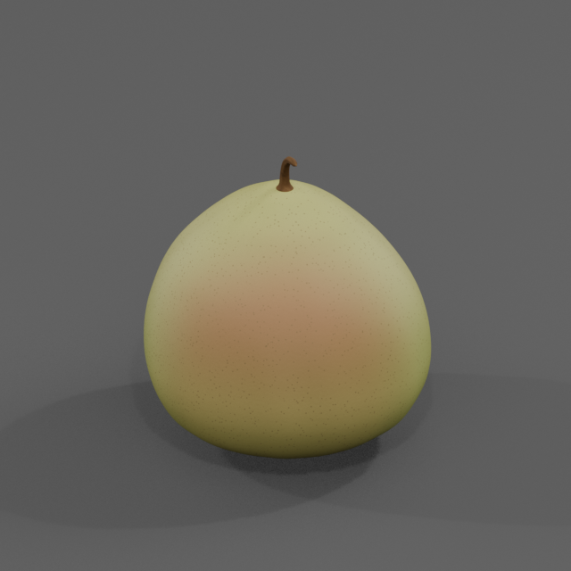
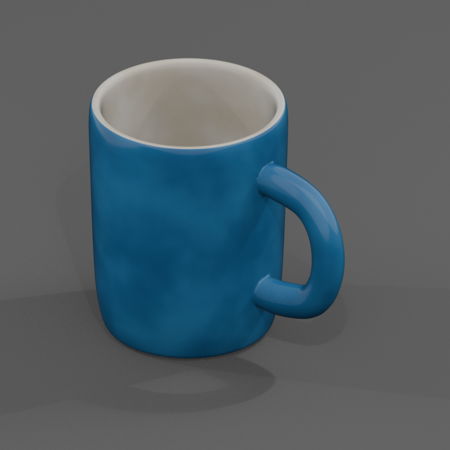
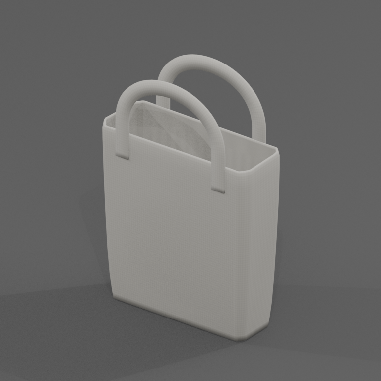
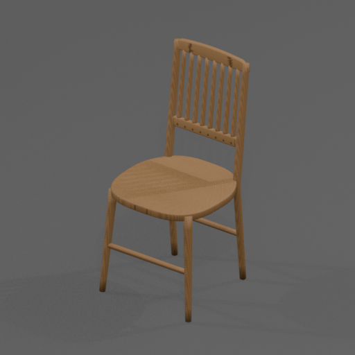

# AgentIn3d

[简体中文](README.md) | English

An Infinigen-based 3D modeling agent that accepts text, a single-subject reference image, or both. The agent writes procedural modeling code and produces multiple views, editable BLEND files, and GLB files with materials.

The core code, Skills, and modeling knowledge are in `inf_agent/`. The current version is 1.1 and supports static single-object assets. Terrain and Sim workflows have not yet been adapted for the agent.

## Showcase

Preview renders of assets generated under `inf_agent/outputs`.

<table>
  <tr>
    <td align="center"><br>Fragrant pear</td>
    <td align="center"><br>Blue-glazed ceramic mug</td>
  </tr>
  <tr>
    <td align="center"><br>Canvas tote bag</td>
    <td align="center"><br>Wooden chair</td>
  </tr>
</table>

## Installation

Prepare Python 3.11, clone this project's repository, and enter its root directory.

```bash
git clone https://github.com/yaojinzhen/AgentIn3d.git
cd AgentIn3d
```

Choose either method below to create `.venv` in the project root.

### Option 1 Use uv

If uv is not installed, install it first. You can also follow the [official installation instructions](https://docs.astral.sh/uv/getting-started/installation/).

Windows PowerShell

```powershell
powershell -ExecutionPolicy Bypass -c "irm https://astral.sh/uv/install.ps1 | iex"
$env:Path = "$env:USERPROFILE\.local\bin;$env:Path"
```

Windows CMD

```bat
powershell -ExecutionPolicy Bypass -c "irm https://astral.sh/uv/install.ps1 | iex"
set "PATH=%USERPROFILE%\.local\bin;%PATH%"
```

These PATH commands make uv available in the current terminal using its default installation directory. Replace the path if you chose a custom directory. Add the directory to your user PATH for persistent access.

Linux/macOS

```bash
curl -LsSf https://astral.sh/uv/install.sh | sh
# or
wget -qO- https://astral.sh/uv/install.sh | sh
```

Once uv is available, create a Python 3.11 environment.

```bash
uv venv --python 3.11 --seed .venv
```

`--seed` provides pip in the environment.

### Option 2 Use Python venv

First, check that the current `python` interpreter is Python 3.11.

```bash
python -c "import sys; assert sys.version_info[:2] == (3, 11), 'Python 3.11 is required'"
```

After the check passes, create the environment.

```bash
python -m venv .venv
```

### Install the Project

After creating the environment with either method, explicitly configure the installation mode and install the project using that environment's pip.

Windows PowerShell

```powershell
$env:INFINIGEN_MINIMAL_INSTALL = 'True'
& .\.venv\Scripts\python.exe -m pip install -e .
```

Windows CMD

```bat
set "INFINIGEN_MINIMAL_INSTALL=True"
.\.venv\Scripts\python.exe -m pip install -e .
```

Linux/macOS

```bash
export INFINIGEN_MINIMAL_INSTALL=True
./.venv/bin/python -m pip install -e .
```

Set `INFINIGEN_MINIMAL_INSTALL` explicitly to `True` or `False`. Installation fails if the variable is unset or its value is invalid. Use `True` for the current single-object workflow. bpy 4.2.0 is installed as a dependency. On Linux, install the corresponding system libraries if an error reports missing graphics libraries.

The examples below use Linux paths. In Windows PowerShell, replace `./.venv/bin/python` with `& .\.venv\Scripts\python.exe`. In Windows CMD, use `.\.venv\Scripts\python.exe`.

## Using Skills

Check the environment first.

```bash
# Linux/macOS
./.venv/bin/python -m inf_agent.cli doctor

# Windows
.\.venv\Scripts\python.exe -m inf_agent.cli doctor
```

The two Skills are located in `inf_agent/skills/`.

- `in3d-generate-asset` generates assets or modifies geometry and materials.
- `in3d-run-asset` executes, exports, or validates existing assets.

Following your agent's conventions, add directory links for these two folders to its configured Skill search directory. Windows can use junctions, and Linux/macOS can use symbolic links. The links point to this project's source directories so that each Skill can locate the root `.venv`. Confirm the destination directory yourself, or provide it to your agent and ask the agent to register the Skills.

Use this project's directory as the agent's project workspace when generating 3D models. After selecting the workspace, you can ask the agent to do the following.

```text
Use in3d-generate-asset to create a ripe red apple with a short stem.
Complete the preview, inspect the actual images, export the asset, and validate it.
```

The basic CLI workflow is shown below. After `start` creates a workspace, the agent writes its `asset.py`, then runs preview and export.

```bash
./.venv/bin/python -m inf_agent.cli start --asset-id apple --prompt "a ripe red apple with a short stem"
# The agent writes inf_agent/outputs/apple/asset.py
./.venv/bin/python -m inf_agent.cli preview --workspace inf_agent/outputs/apple
./.venv/bin/python -m inf_agent.cli export --workspace inf_agent/outputs/apple
```

Results are saved under `runs/<run-id>/` in the asset workspace. Commands return the file paths. See the [Agent documentation](inf_agent/docs/README.md) for usage and output details.

## Project Structure

| Directory | Contents |
| --- | --- |
| `inf_agent/` | Agent core, Skills, modeling knowledge, and regression tests |
| `infinigen/` | Underlying generators, materials, tools, and retained extension code |
| `infinigen_examples/` | Upstream generation code and configuration required at runtime |
| `scripts/` | Retained scripts for underlying tools |

See the [Agent README](inf_agent/README.md) for project interfaces, maintenance checks, and documentation links.

## Attribution and Licenses

This independently maintained project is based on [Infinigen](https://github.com/princeton-vl/infinigen). Infinigen's BSD-licensed code is covered by the root [LICENSE](LICENSE). Original Agent code is covered by [BSD-3-Clause](inf_agent/LICENSE), and original copyright headers are retained. The project includes GPL code, and combined distributions containing that code must comply with [GPL v3](infinigen/infinigen_gpl/LICENSE). Other components are governed by the LICENSE, COPYING, OFL, and file-header notices in their directories. Supplemental license texts are in [LICENSES](LICENSES).

## Acknowledgments and Citations

We thank the Infinigen team at Princeton Vision & Learning Lab and all contributors for the open-source procedural generators, materials, and tools that form the foundation of AgentIn3d. [Infinigen project](https://github.com/princeton-vl/infinigen)

- *Infinite Photorealistic Worlds Using Procedural Generation*. CVPR 2023. [Paper](https://arxiv.org/abs/2306.09310)
- *Infinigen Indoors: Photorealistic Indoor Scenes using Procedural Generation*. CVPR 2024. [Paper](https://arxiv.org/abs/2406.11824)

```bibtex
@inproceedings{infinigen2023infinite,
  title={Infinite Photorealistic Worlds Using Procedural Generation},
  author={Raistrick, Alexander and Lipson, Lahav and Ma, Zeyu and Mei, Lingjie and Wang, Mingzhe and Zuo, Yiming and Kayan, Karhan and Wen, Hongyu and Han, Beining and Wang, Yihan and Newell, Alejandro and Law, Hei and Goyal, Ankit and Yang, Kaiyu and Deng, Jia},
  booktitle={Proceedings of the IEEE/CVF Conference on Computer Vision and Pattern Recognition},
  pages={12630--12641},
  year={2023}
}

@inproceedings{infinigen2024indoors,
    author    = {Raistrick, Alexander and Mei, Lingjie and Kayan, Karhan and Yan, David and Zuo, Yiming and Han, Beining and Wen, Hongyu and Parakh, Meenal and Alexandropoulos, Stamatis and Lipson, Lahav and Ma, Zeyu and Deng, Jia},
    title     = {Infinigen Indoors: Photorealistic Indoor Scenes using Procedural Generation},
    booktitle = {Proceedings of the IEEE/CVF Conference on Computer Vision and Pattern Recognition (CVPR)},
    month     = {June},
    year      = {2024},
    pages     = {21783-21794}
}
```
